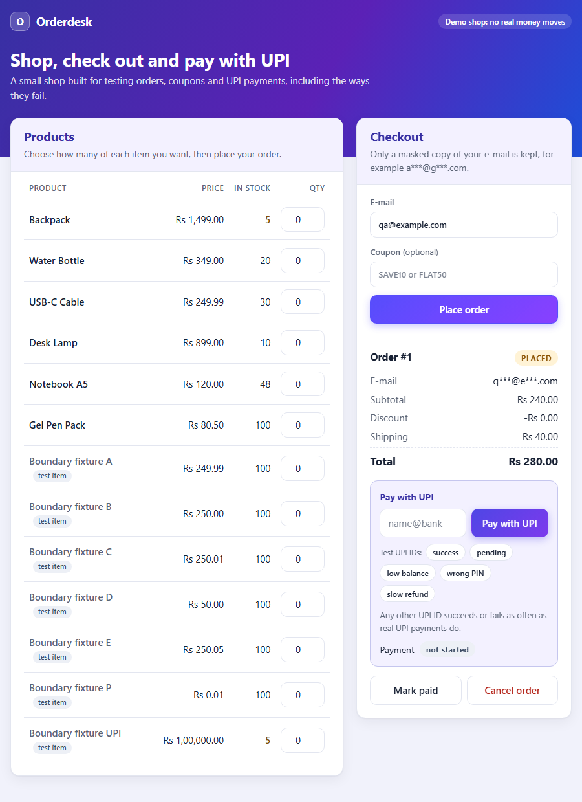
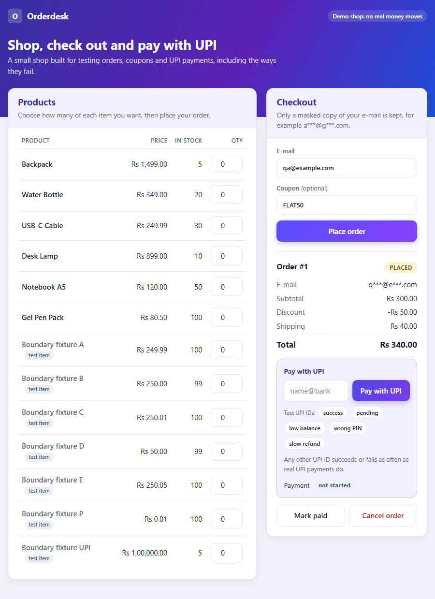

# Orderdesk QA Suite: API, SQL and browser testing of an order service

[](https://github.com/Anubhavkumarkanth/orderdesk-qa-suite/actions/workflows/ci.yml)

A small order-processing application (FastAPI + SQLite + one HTML checkout page) and the test suite I wrote for it: **144 automated tests across API, database and browser layers**, a written test plan, requirement-to-test traceability, and reproducible bug reports. It includes a **UPI payment failure lab**: a pretend UPI provider that fails payments with NPCI's error codes at the real decline rates measured by my [UPI Pulse](https://anubhavkumarkanth.github.io/upi-pulse/) tracker.

## Live app
[Open Orderdesk](https://orderdesk-qa-suite-live.onrender.com): the same API and checkout page the tests run against, with real e-mail validation. It keeps only a masked copy of the e-mail you type (`anubhav@gmail.com` is stored as `a***@g***.com`), so no full address is ever stored or shown. After placing an order you can pay with a pretend UPI ID (tap one of the test IDs under the Pay box): `success@sandbox`, `pending@sandbox`, or a failure code such as `z9@sandbox` (not enough money) or `zm@sandbox` (wrong PIN). Pay with `refund-pending@sandbox` and then cancel the order to see a refund the bank has not confirmed yet. Any other UPI ID succeeds or fails as often as real UPI payments do. No money moves, and the UPI ID is never stored. Orders reset when the free host restarts, and the first visit after a quiet spell can take up to a minute.

The application contains **8 defects that I seeded deliberately** and can switch on one at a time. That lets the repository show the whole defect cycle with real evidence: reproduce, report, fix, and prove a test now guards it.

> Honest framing: I wrote the application, the requirements, the defects and the tests. The suite catching all 8 defects shows its sensitivity to those kinds of faults. It does not show that I found bugs in software I did not write, and nothing here claims that.



## Why this stack
I read nine fresher-level Data Analyst and QA postings in Bengaluru and across India (sources and method in [`docs/market-research.md`](docs/market-research.md)). In the three QA postings, manual testing with test cases and bug reports, Jira, and API testing (Postman or similar) appeared in all three, Selenium or Playwright in two, and SQL in two. So the project leads with test design and defect reports, adds API tests and SQL checks, and uses one browser-automation layer. Playwright was chosen because it installs and runs reliably here; Selenium is more common in those postings, and the concepts (locators, waits, page state) carry over, but I have not used Selenium in this project.

## Quick start
Python 3.10+ (developed on 3.12).

```bash
git clone https://github.com/Anubhavkumarkanth/orderdesk-qa-suite.git
cd orderdesk-qa-suite
python -m venv .venv && source .venv/bin/activate      # Windows: .venv\Scripts\activate
pip install -r requirements.txt
python -m playwright install chromium
python -m pytest -v                                    # clean build: expect 144 passed
python scripts/defect_matrix.py                        # runs the suite once per seeded defect (about 8 minutes)
```

Run the app yourself: `uvicorn app.main:app` then open http://127.0.0.1:8000 (interactive API docs at `/docs`). Switch a defect on with `ORDERDESK_DEFECTS=BUG-004` (or `all`); unset it for the correct build. `ORDERDESK_TEST_MODE=1` enables the reset endpoint the tests use.

## What is tested
| Layer | Tests | Techniques | Folder |
|-------|------:|------------|--------|
| API | 113 | Boundary values (quantity, coupon minimums, free-shipping threshold), equivalence partitions (e-mail), state-transition table (12 invalid transitions), rounding edge case, all-or-nothing stock handling, negative cases; UPI payment states, repeated and forged callbacks, refunds after cancel, retry rules, reconciliation, 500 buyers for the last 5 units, a success after a failure, a wrong amount in a callback, refunds that fail, the UPI limit | `tests/api/` |
| Database | 8 | SQL invariants after a mixed scenario: totals identity, subtotal = sum of items, stock conservation, no negative stock, FK consistency, no double charge | `tests/db/` |
| Browser | 21 | Catalogue and stock display, order summary figures, coupon total, validation message, cancel flow, blocked cancel after shipping, UPI decline shown with its reason, phone on 3G with a double tap on Pay, a bank slower than a minute, a phone that goes offline mid-payment, the refund shown after a cancel, errors in plain English, a lost connection or reply, a double click on Place order; screenshot saved on failure | `tests/ui/` |
| Simulator | 2 | The pretend provider's codes match NPCI's list and its decline rates match UPI Pulse | `tests/unit/` |

(144 tests come from 73 test cases once parametrized; see [`docs/traceability.md`](docs/traceability.md).)

Documents: [requirements](docs/requirements.md) (the test oracle), [test plan](docs/test-plan.md), [test cases](docs/test-cases.md), [traceability](docs/traceability.md), [UPI failure lab](docs/upi-failure-lab.md).

## UPI payment failure lab
The lab adds UPI payment to the checkout through a pretend provider (`app/upi_provider.py`):

- **Real codes:** wrong PIN (ZM), not enough money (Z9), risk limit (U16), request expired (U69), debit failed at the bank (U30) and debit timeout (U67), each checked against NPCI's *Error and Response Codes* v2.9.
- **Real rates:** over the last 12 months, 9.62% of UPI payments were declined for business reasons and 0.29% for technical ones at the payer's bank (UPI Pulse, from NPCI's monthly figures). The provider fails payments at those rates.
- **Payment states:** every payment starts `PENDING` and ends `SUCCESS` or `FAILED`, read by a signed callback, a status check or a reconciliation run. A success that arrives after a cancel, or after the payment failed, is refunded, and a refund counts only once the provider confirms it.
- **Risk-ranked tests:** each new case is ranked by how often the problem happens x how much it hurts. The top three: a paid order not marked paid, a second attempt while one is pending, and a payment left pending after a lost callback. The ranking, sources and honest limits are in [`docs/upi-failure-lab.md`](docs/upi-failure-lab.md).
- **Edge cases suggested by AI, kept after review:** Claude suggested 8 payment edge cases and I kept 6: a success after a failure, a page that gives up after a minute, a phone that goes offline, a callback with the wrong amount, a refund that fails, and orders above UPI's Rs 1 lakh limit for one payment. That limit is as reported in the news; NPCI's own text could not be checked (details in the lab document).
- **Each new test was shown to fail:** I broke the code 34 ways, one at a time (no refund, no signature check, no lock, and so on), and each time the matching test failed.

## Results
Recorded runs, Windows 11, Python 3.12, Chromium via Playwright:

- **Clean build:** `144 passed in 50.63s` ([full log](reports/results-clean-build.txt)).
- **Defect detection:** every seeded defect is caught by at least one test, and the clean build has zero failures ([matrix](reports/defect-matrix.md)).

| Defect | What is wrong | Caught by |
|--------|---------------|-----------|
| [BUG-001](docs/bugs/BUG-001.md) | Quantity 11 accepted (limit 10) | 1 test (boundary value 11) |
| [BUG-002](docs/bugs/BUG-002.md) | SAVE10 rejected at exactly Rs 500.00 | 3 tests |
| [BUG-003](docs/bugs/BUG-003.md) | Free shipping lost after a discount | 1 test |
| [BUG-004](docs/bugs/BUG-004.md) | Cancel does not return stock | 6 tests across API, SQL and browser |
| [BUG-005](docs/bugs/BUG-005.md) | Shipped order can be cancelled | 2 tests (API, browser) |
| [BUG-006](docs/bugs/BUG-006.md) | `user@nodot` accepted as e-mail | 1 test (one equivalence partition) |
| [BUG-007](docs/bugs/BUG-007.md) | Discount truncated, not rounded half up (1 paisa) | 1 test |
| [BUG-008](docs/bugs/BUG-008.md) | Checkout page total ignores the coupon | 1 browser test; the API tests all pass in that build |

Each bug report has steps, expected vs actual, the real request/response captured by `scripts/capture_evidence.py`, root cause, fix and the guarding test. BUG-008 also has before/after screenshots.



## CI
GitHub Actions ([`ci.yml`](.github/workflows/ci.yml)) installs dependencies and Chromium, requires the clean build to be fully green, then runs the defect matrix and fails if any seeded defect goes undetected.

## Limitations
- **The defects and tests share an author.** Detection rates show the suite's sensitivity to these fault types, not how it would fare against defects I did not anticipate.
- Not covered: performance and load, security testing beyond callback signatures, accessibility auditing, cross-browser testing, real phones, a real payment gateway.
- The UPI provider is simulated. Only its codes (NPCI) and its two decline rates (UPI Pulse) are real; how often callbacks repeat or customers double-tap is assumed, not measured.
- Chromium only, and the phone in TC-UI-008 is emulated in desktop Chromium. No Selenium and no Postman collection in this project.
- The 8 seeded defects predate the payment lab. The new tests were checked with one-off broken builds instead, recorded in the lab document, not with new seeded defects.
- The five manual cases in [`docs/test-cases.md`](docs/test-cases.md) are designed but **not executed**; no manual execution results are claimed.
- The specification is mine, written alongside the code, so it is a clean oracle rather than an ambiguous client document. Real requirements are rarely this tidy.
- Boundary fixtures (`BND-*` products, including a Rs 1,00,000 one for the UPI limit) exist only to hit thresholds exactly; they would not exist in a real catalogue.

## Layout
```
app/        main.py (API)  pricing.py (rules)  db.py (SQLite)  defects.py (switches)  upi_provider.py (pretend UPI)  static/index.html
tests/      api/ db/ ui/ unit/  conftest.py (starts the real server, resets data per test)
docs/       requirements  test-plan  test-cases  traceability (generated)  upi-failure-lab  bugs/ (8 reports + evidence)
scripts/    defect_matrix.py  capture_evidence.py  make_traceability.py  make_bug_reports.py  upi_rates.py
reports/    results-clean-build.txt  defect-matrix.md/json  screenshots/
```

MIT licensed.

