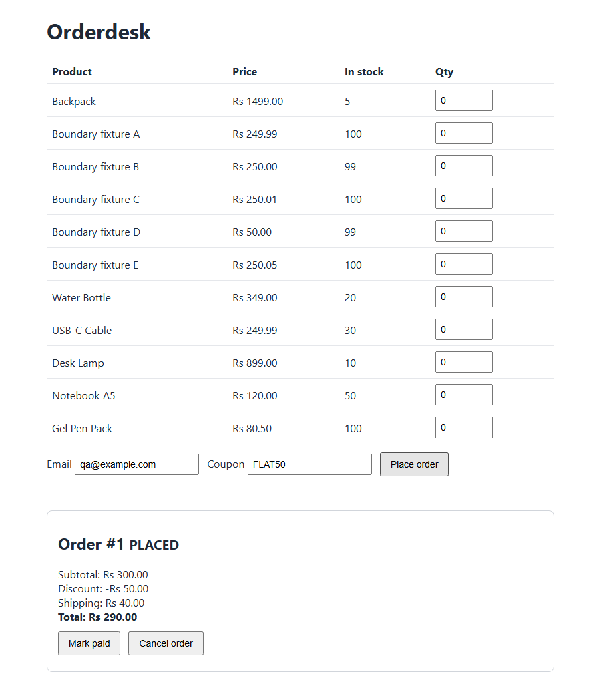

# BUG-008: Checkout page shows a total that ignores the coupon

| Field | Value |
|---|---|
| Severity | High |
| Component | UI |
| Requirement | REQ-UI-001 |
| Origin | **Seeded deliberately** (`ORDERDESK_DEFECTS=BUG-008`); not a defect in third-party software |
| Status | Fixed in the clean build; guarded by the tests below |

## Steps to reproduce
1. Open the checkout page.
2. Enter quantity 1 for `BND-B` and `BND-D` (Rs 300.00), e-mail `qa@example.com`, coupon `FLAT50`.
3. Click Place order and read `Total`.

## Expected
`Total: Rs 290.00` (300.00 - 50.00 + 40.00 shipping), the same as the API.

## Actual
`Total: Rs 340.00`: the page adds subtotal and shipping but omits the discount, while the API and database hold 290.00.

## Evidence
Captured by `scripts/capture_evidence.py` from a clean build and a defective build (`docs/bugs/evidence/BUG-008.json`):

```json
{
  "step": "UI: BND-B x1 + BND-D x1, coupon FLAT50, click Place order; read 'Total'",
  "clean_build_total_shown": "Rs 290.00",
  "defective_build_total_shown": "Rs 340.00",
  "api_total_in_both_builds": "Rs 290.00 (29000 paise)"
}
```




## Root cause
`app/static/index.html` `render()`: when the defect is on, the displayed total is `subtotal_paise + shipping_paise` instead of `order.total_paise`.

## Fix and verification
Display `order.total_paise`. Verified: the guarding test(s) fail with the defect on and pass on the clean build (see `reports/defect-matrix.md`).

Guarded by: `tests/ui/test_checkout_ui.py::test_tc_ui_003_coupon_discount_is_reflected_in_the_total`. The API tests pass in this build, which is why a browser test is needed.

## Why this test design catches it
UI and API disagree; only an end-to-end check sees what the customer sees.
